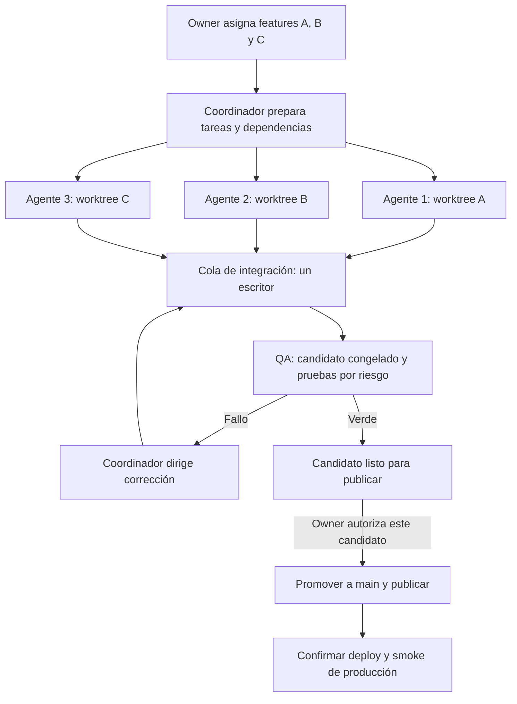

> Investigación/plan previo. El owner adoptó el piloto en ADR0144; las reglas vigentes están en TRABAJO-EN-PARALELO, AGENT-WORKFLOW y VERIFICACION. Este documento conserva el razonamiento previo y no impone gates adicionales.

# Orquestación de features en paralelo para CheckPoint

Fecha: 2026-10-13. Estado: **investigación y diseño propuesto; todavía no implementado**.

**Revisión posterior:** [ajustes completos del harness](revision-ajustes-harness-multiagente-2026-10-13.md). Corrige esta propuesta para GPT UI/backend cuando el owner apruebe el cambio, coordinación de migraciones, selección de release, hooks, preparación de entornos y un piloto con menos carga documental. Ante diferencias entre propuestas, usar esa revisión como diseño más reciente; ninguna modifica las reglas vigentes.

Este documento completa [el análisis del harness](analisis-harness-codex-2026-10-13.md). El pedido es poder asignar features a distintos agentes, contar con un coordinador que prepare y supervise sus trabajos y tener un responsable de pruebas que valide la combinación antes de publicar. La optimización de tests es una parte de ese sistema.

## Recomendación

Un coordinador persistente, un worktree por feature, una cola de integración y un agente de QA compartido. El coordinador toma decisiones y dirige correcciones; un controlador pequeño aplica las reservas, comprueba entregas y registra resultados. Solo el coordinador puede promover el candidato final y solicitar/publicar el release autorizado.

La unidad de asignación es la **feature**, con sus criterios de aceptación y dependencias. Los roles de UI/backend pueden colaborar dentro de ella cuando las zonas del repo lo exijan. No hay que convertir todas las features en una cadena de diseñador → frontend → backend → revisor → tester.

Las reglas de aislamiento, estados, invalidación y publicación que siguen son una propuesta de ingeniería para este repo. La documentación oficial confirma las capacidades de los runtimes; no garantiza que un grupo de agentes respete por sí solo este protocolo.

## Capacidades investigadas y elección del runtime

| Opción | Lo que aporta | Uso recomendado aquí |
| --- | --- | --- |
| Subagentes nativos | Delegación, seguimiento y recogida de resultados | Piloto supervisado, investigación y trabajos acotados; comprobar el directorio real de cada escritor |
| Chats en worktrees | Checkouts separados para trabajar simultáneamente | Aislamiento de cada feature, con ramas locales sin push |
| Codex SDK | Iniciar, continuar y reanudar threads locales | Controlador programático pequeño que sobreviva a sesiones del coordinador |
| Codex App Server | Conversaciones, eventos y solicitudes de aprobación para clientes propios | Si hace falta controlar en detalle clientes, permisos y seguimiento interactivo |

OpenAI documenta los subagentes y recomienda cautela con la escritura simultánea. Crear un subagente no debe tomarse como prueba de que se creó un checkout separado. En esta sesión, los agentes comparten inicialmente carpeta; habría que asignar y comprobar el worktree antes de permitir escritura. [Subagentes](https://learn.chatgpt.com/docs/agent-configuration/subagents).

Los worktrees de Codex permiten seleccionar una base y trabajar en un checkout separado, normalmente con HEAD detached. Los archivos ignorados requieren preparación específica y una rama solo puede estar checked out en un worktree. Para este flujo propongo refs locales estables que preserven las entregas. [Worktrees](https://learn.chatgpt.com/docs/environments/git-worktrees).

El SDK permite iniciar, continuar y reanudar threads por ID. App Server ofrece eventos y decisiones de aprobación. Recomiendo comenzar con el SDK y usar App Server directamente solo si el piloto muestra una necesidad que el SDK elegido no cubre. Son interfaces diferentes y se debe fijar su versión antes de implementar. [Codex SDK](https://learn.chatgpt.com/docs/codex-sdk), [App Server](https://learn.chatgpt.com/docs/app-server).

Hay un ejemplo oficial con coordinador y especialistas que sirve como referencia conceptual para los handoffs. Está archivado y depende de `codex mcp-server`; **no usar ese código como base nueva**. La documentación del SDK indica que ese comando fue eliminado; el artículo archivado todavía lo describe como deprecado. Para nuevas integraciones usar las interfaces actuales. [Ejemplo archivado](https://developers.openai.com/cookbook/examples/codex/codex_mcp_agents_sdk/building_consistent_workflows_codex_cli_agents_sdk).

No hace falta añadir otro framework de agentes para empezar. La elección oficial distingue trabajos acotados con `codex exec`, flujos programáticos con SDK y clientes con App Server. Si después queremos incluir Claude, el controlador puede tener un adaptador por runtime y mantener el mismo contrato de tarea; esa integración no se investigó ni se probó aquí. [Elección de interfaz](https://developers.openai.com/blog/codex-as-a-platform).

## Organización del equipo

| Responsable | Hace | Entrega |
| --- | --- | --- |
| Coordinador | Descompone features, prepara contexto/entorno, reserva recursos, desbloquea dependencias, integra y dirige arreglos | Estado del lote, candidato y decisión de preparación para release |
| Agente de feature | Implementa su encargo en su worktree y comprueba lo indispensable durante desarrollo | Commits, diff y handoff con evidencia focal |
| Agente de QA | Revisa aceptación e interacciones, selecciona/ejecuta pruebas y devuelve fallos concretos | Resultado ligado al candidato exacto |
| Controlador determinista | Valida reservas/paths/refs, administra procesos y recursos y conserva el registro | Estado recuperable y operaciones comprobables |

El coordinador puede corregir integración rutinaria dentro de su autorización. Una corrección de negocio vuelve al responsable apropiado o a una tarea acotada; QA verifica el nuevo resultado. Ser coordinador no concede acceso automático a zonas de Claude, al kit o a migraciones.

QA es independiente de quienes implementaron las features del candidato. No agrega un segundo revisor por cada feature L2. Una revisión especialista adicional se justifica por riesgo crítico o un hallazgo concreto.

**Capacidad:** esta sesión permite cuatro agentes activos en total. Coordinador + tres implementadores llena los cuatro lugares; QA empieza cuando termina alguno. Si queremos QA desde el principio, usar coordinador + dos implementadores + QA y encolar la tercera feature. Los roles no requieren cinco procesos permanentes. No prometer concurrencia que el runtime no admite.

## Flujo de punta a punta



1. El coordinador obtiene una base comprometida y conocida. Los cambios sin commit de otra sesión quedan fuera; no se stashean ni se incluyen automáticamente. Si la base tiene un rojo previo, lo identifica y aplica la regla vigente de arreglarlo antes en la zona responsable.
2. Construye un grafo de dependencias: lo independiente arranca junto; una feature que necesita un contrato pendiente puede adelantar UI con fixture pactado, pero no se declara lista para integrar sin comprobar la dependencia real.
3. Reserva paths y recursos, crea worktrees locales y ejecuta una preparación barata del entorno. No escribe producto ni corre toda la suite para comprobar que un agente puede empezar.
4. Cada implementador trabaja sobre su base asignada. El coordinador recibe progreso y bloqueos; no actualiza su checkout por detrás mientras está ejecutando pruebas.
5. El agente entrega commits concretos y deja limpio su worktree. El controlador comprueba autoría del alcance, archivos tocados, dependencias y evidencia; un mensaje de «listo» no basta.
6. El coordinador incorpora entregas en orden de dependencias, de una en una, en el checkout de integración. Para el piloto, usar cherry-pick de commits declarados y registrar sus SHAs de origen/destino. Nunca cherry-pickear un rango que arrastre commits de otra feature.
7. Congela un candidato con las features elegidas. QA trabaja en una copia del candidato, con builds y puertos propios. Otros agentes pueden continuar en sus worktrees mientras ese candidato se verifica.
8. Si QA encuentra un fallo, registra reproducción y responsable. La corrección genera otro candidato; se repiten los gates afectados y se amplía solo si cambia el alcance. No se reutiliza el PASS completo anterior como PASS del nuevo candidato.
9. El lote queda listo para release con SHA, features incluidas/excluidas, evidencia y límites. Si el owner pide publicar solo A+B, se construye y verifica ese candidato desde la base de release; no se asume que el resultado de A+B+C sirve.
10. Cuando el owner autoriza publicar el candidato, se comprueba que la base remota no cambió, se promueve y se publica. Si cambió, hay que integrar y verificar la combinación nueva antes de continuar. Se confirma el deploy real y se realiza un smoke pequeño sin escrituras destructivas en producción.

La rama `dev` puede seguir siendo el lugar de integración y QA local del owner. Solo su coordinador escribe allí durante el lote. Las ramas de feature permanecen locales: no necesitan previews ni PRs para funcionar. La implementación debe preservar la historia ya existente en `dev` y `main`, no reconstruirlas con resets.

## Qué recibe cada agente antes de arrancar

Una ficha breve por tarea, no todo el historial de todos los agentes:

```yaml
id: feature-A
objective: criterio observable del producto
base_sha: commit asignado
worktree: ruta absoluta asignada
thread_id: id registrado por el controlador
allowed_paths: [paths de implementación y tests propios]
shared_resources: [contratos o registros solicitados]
depends_on: [id y entrega necesaria, si corresponde]
contract: referencia y versión del contrato HTTP
acceptance: [criterios y casos de error relevantes]
risk: L2
environment: referencia a configuración de prueba, sin secretos
ports: [puertos reservados]
checks: [comandos focales con sus condiciones]
out_of_scope: [límites del encargo]
```

Además: instrucciones comunes breves, spec cerrada cuando corresponda, referencias puntuales, herramientas necesarias, fixtures/datos locales y persona/agente al que pedir piezas faltantes. El coordinador comprueba Node 24, instalación por lockfile, configuración no productiva y puertos. No copia todos los `.env` del checkout principal; entrega solo configuración de prueba necesaria.

Un agente puede crear archivos nuevos solo dentro de sus paths; debe declarar renames/deletes, imports y consumidores afectados. Necesitar una pieza compartida genera una solicitud al coordinador, que la asigna al dueño o serializa el cambio. No hace falta preguntarle al owner por cada decisión rutinaria.

## Cómo se evita que se pisen

**Archivos:** un worktree por escritor. Los workers no hacen `git switch`, `git add`, commits ni restauraciones en el checkout de integración. Cada uno prepara exclusivamente sus archivos. El coordinador reserva también globs y detecta solapamientos padre/hijo, no solo coincidencias de nombres exactos.

**Estado compartido:** `docs/INDEX.md`, reservas de spec/ADR, lockfile, registros de módulos, manifiestos, kit y contratos tienen un único responsable por cambio. Los agentes pueden proponer una modificación; el propietario la incorpora una vez. Dos features que necesitan el mismo contrato se coordinan antes de implementar, aunque toquen archivos distintos.

**Git:** los worktrees comparten objetos, refs y parte de la configuración Git. Son aislamiento de trabajo, no una frontera de seguridad. Las restricciones sobre refs, push y paths deben aplicarse también en herramientas/permisos del controlador y validación de entrega. Para agentes no confiables se requieren repos o sandboxes separados.

**Runners:** `.next`, reportes, perfiles de browser y puertos propios. Se puede compartir la caché de paquetes, pero no artefactos mutables de build. El controlador limita trabajos pesados según capacidad de la máquina; empezar tres builds y tres browsers simultáneos puede empeorar el tiempo y producir falsos rojos.

**DB:** una base/branch de prueba por runner que necesite escribir, o exclusión explícita sobre la base compartida. Primera versión recomendada: integración DB serializada usando el wrapper permitido; unitarios y browser HTTP simulado siguen en paralelo. Migraciones y reset pertenecen al mismo lock de DB. Nunca `DATABASE_URL` de producción para tests.

**Bloqueos:** reserva atómica con task ID, dueño, recurso y generación. Heartbeat y timeout detectan abandono; el timeout no autoriza una segunda escritura mientras el proceso viejo siga vivo. Se detiene/confirma el proceso anterior y se revoca su generación antes de reasignar. Para empezar basta un registro local con un solo escritor y operaciones atómicas; no hace falta infraestructura distribuida.

## Estado recuperable, fallos y handoffs

Estados mínimos de tarea: `pendiente → preparada → ejecutando → entregada → integrada`. QA/release son estados del candidato: `verificando → requiere_correccion | listo → publicando → publicado`. El estado `bloqueada` incluye motivo y dependencia; no se confunde con feature terminada.

Cada entrega registra base, commits, paths reales, versión de contrato, comandos/resultados, criterios cumplidos y límites. El controlador conserva task/thread IDs, worktree, recursos, candidato y un log de eventos. Un archivo propio por entrega evita que todos escriban el mismo estado.

Tras un reinicio, el coordinador lee ese registro y reconcilia refs, procesos y locks antes de reanudar. Lanzar dos veces la misma tarea no crea dos escritores; integrar dos veces la misma entrega no reaplica commits. Un crash durante publicación se reconcilia con el SHA remoto y el estado del deploy antes de repetir el push. Un timeout no significa PASS ni autoriza publicación.

Si hay conflicto textual, se resuelve antes de verificar. Si hay conflicto semántico —por ejemplo dos permisos con interpretaciones distintas— se corrige el contrato o la implementación y se verifica la interacción. Git sin conflictos no garantiza compatibilidad.

## Pruebas suficientes sin repetición excesiva

QA define una cobertura breve al preparar las tareas y la ajusta al diff real. Los implementadores conservan feedback rápido; centralizar QA no significa entregar código sin compilar ni comprobar su comportamiento básico.

| Etapa/cambio | Qué comprobar | Responsable |
| --- | --- | --- |
| Desarrollo de cada feature | Formato/lint/guardias/tipos pertinentes y casos focales de comportamiento | Implementador |
| Ajuste L0/L1 | Revisión y comprobación puntual proporcional; sin test nuevo por ceremonia | Implementador; QA consume evidencia si pertenece al lote |
| Feature L2 | Aceptación, errores relevantes y pruebas de la capa que cambió | QA, reutilizando evidencia compatible |
| Integración A+B+C | Tipos/build de apps afectadas, fronteras e interacciones identificadas, smoke real cuando cambia cableado | QA sobre el candidato congelado |
| Dinero/auth/tenant/migraciones | Invariantes y negativos decisivos; integración aislada y concurrencia donde corresponde | QA y especialista solo si el riesgo lo exige |
| Impacto desconocido o transversal L3 | Ampliar a dominios/suite global según el lote | Un runner central, no uno por feature |
| Release | Controles obligatorios del candidato y confirmación del deploy | Coordinador + QA |

Ejemplo: A cambia Recetas, B cambia Equipo y C cambia una sección pública. Durante desarrollo cada agente valida su superficie. Al integrar, QA comprueba aceptación de cada una y la interacción Recetas/permisos si existe. La landing no activa Neon por ser UI. No se repiten tres suites completas antes de juntar los commits y otra completa solo por fast-forward.

Para cada prueba se define el fallo que debe detectar. Un caso crítico de aislamiento entre negocios merece un negativo real; no basta el botón oculto en un mock. Una regla aritmética se prueba en unitarios y no necesita todas sus combinaciones en browser. Un screenshot guardado no equivale a una aserción visual.

**Evidencia:** guardar candidato/SHA, entradas del gate (código/tests/config/dependencias), base, selector, runtime/entorno, DB/esquema si aplica, comando y resultado/skips. Cada gate decide qué cambios lo invalidan. Primera versión: reutilizar únicamente con identidad comprobada de entradas; si no se sabe acotar, repetir ese gate. No construir inicialmente un grafo sofisticado de caché.

El hook comprueba el resultado que corresponde a la ref que realmente se empuja; si falta o está invalidado, ejecuta el gate pendiente. Un PASS en Markdown no constituye esa comprobación. CI en Linux puede conservar una red independiente; no se añade un segundo verify manual por ceremonia. Los gates completos periódicos pueden detectar huecos del selector, pero nunca reemplazan una comprobación obligatoria del release.

## Publicación y recuperación de producción

Preparar y autorizar release son acciones distintas. El coordinador deja el lote concreto listo, y el owner puede autorizar su publicación sin volver a organizar a los agentes. Si ya autorizó ese candidato/acción en la sesión, no se pide otra confirmación por rutina.

**Límite actual:** el CI del repo se dispara al push a `main`, mientras ese mismo push inicia el deploy según ADR 0128. No se puede presentar ese CI como gate previo garantizado de producción. En el piloto se conserva el gate local actual. Si se quiere que CI sea condición previa, hay que preparar una verificación del SHA candidato antes del push, o configurar una promoción de deploy condicionada a CI; eso requiere implementación y verificar la configuración real de hosting.

El release registra SHA anterior y nuevo, features incluidas, evidencia y resultado del deploy. El procedimiento de recuperación debe distinguir código y datos: restaurar una versión de aplicación no revierte una migración ni deshace cobros. Para cambios de esquema se necesita compatibilidad y plan específico del responsable de DB antes de publicarlos. El smoke productivo usa comprobaciones de lectura o un entorno/actor controlado autorizado, no repite integración contra producción.

## Qué debe cambiar en las reglas de CheckPoint

| Regla actual | Cambio propuesto |
| --- | --- |
| ADR 0128: todos escriben en la misma carpeta/dev | Mantener dev de integración y permitir worktrees/ramas locales por tarea; solo un integrador |
| ADR 0129 / AGENT-WORKFLOW: subagentes solo L3 | Elegir concurrencia por independencia de tareas y capacidad; riesgo determina pruebas/revisión |
| AGENTS vs reglas comunes: main/pull/reservas contradictorias | Unificar el inicio y reservar specs localmente mediante el coordinador |
| GPT UI / Claude backend-kit-tooling | Mantener zonas; coordinar features y contratos sin conceder permisos globales implícitos |
| Implementador y revisor ejecutan todo | Implementador focal, QA central y gate válido por candidato |
| Verify mide todo contra origin/main incluso durante tareas | Separar alcance de tarea, integración y release; incluir UI modular/harness dinámico |
| Hook verifica working tree | Verificar/reforzar evidencia del SHA realmente empujado |

Estos cambios deben quedar coherentes en instrucciones, plantillas y herramientas. Este documento no deroga ADRs ni modifica permisos. No se implementa un piloto escritor bajo reglas contradictorias fingiendo que ya están resueltas.

## Implementación mínima por etapas

1. **Política común:** cerrar la decisión de worktrees, roles, zonas y QA; ajustar ADRs/instrucciones. Evitar una spec larga por cada tarea pequeña; las features funcionales conservan su spec chica.
2. **Piloto supervisado:** dos features independientes, dos worktrees, coordinador y QA; handoffs breves y una integración serial. Usar comandos existentes sin cambiar hooks para eludir checks. Observar colisiones, bloqueos y tiempos.
3. **Controlador pequeño:** preparación de worktrees/entornos, registro recuperable, reservas, lanzamiento/continuación de threads, comprobación de entregas y cola de integración. Sin dashboard, scheduler distribuido ni sistema propio de CI.
4. **QA eficiente:** modos tarea/candidato/release, mapa explícito de cobertura por dominio/harness, separación unit/DB y evidencia vinculada a gates. Ajustar hook/CI para consumirla con fallback seguro.
5. **Release:** publicar candidato elegido, confirmar deploy, smoke y recuperación; configurar CI previo/promoción solo si se decide exigirlo.

Tooling/hooks/CI son implementación de Claude por las zonas vigentes; GPT puede preparar contratos, documentación, UI/e2e y revisar resultados. Si queremos que un agente se encargue de una feature completa cruzando zonas, esa autorización se debe hacer explícita en la política.

## Cómo demostrar que funciona

El piloto se aprueba si las features cumplen aceptación juntas, no invaden paths ajenos, ningún proceso usa DB/artefactos de otro, QA identifica el candidato y la publicación puede prepararse/reanudarse sin perder entregas. Se prueba además un reinicio del coordinador y un solapamiento de reserva rechazado: comprueban fallos reales de coordinación, no añaden casos triviales a producto.

Medir tiempo hasta candidato listo, tiempo de pruebas, gates duplicados, rojos de entorno, defectos de integración y tiempo bloqueado por dependencia. No prometer ahorro antes de medir. El objetivo es poder dar encargos por feature y recibir una combinación verificable, con intervención del owner en decisiones de producto y publicación.

## Alcance real de esta investigación

Se leyeron el análisis previo, las reglas de trabajo, el estado GPT vigente, ADRs 0128/0129, AGENT-WORKFLOW, hook y CI; se consultaron páginas oficiales actuales. Se ejecutó `pnpm ci:status` con Node 24.20.0: el último main remoto consultado seguía rojo por el e2e POS descrito en el estado previo. Hay cambios paralelos sin commit en backend; se preservaron.

No se corrieron suites de producto, ni se crearon worktrees/agentes escritores, ni se cambió código, configuración, ramas, migraciones o despliegues. La arquitectura está investigada y documentada; no se afirma que el controlador o el flujo propuesto ya estén funcionando.
