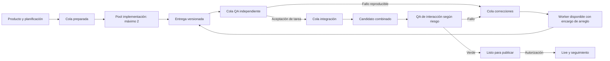

> Investigación/plan previo. El owner adoptó el piloto en ADR0144; las reglas vigentes están en TRABAJO-EN-PARALELO, AGENT-WORKFLOW y VERIFICACION. Este documento conserva el razonamiento previo y no impone gates adicionales.

# De piloto multiagente a flujo continuo de software

Fecha: 2026-10-13. Estado: **investigación y propuesta, sin instalación ni implementación**. Continúa vigente esperar el cierre de Claude y la integración/sincronización anterior.

Pedido: evaluar una cola de features/tareas con implementadores limitados, QA independiente mientras los autores empiezan otra tarea, correcciones reasignables e integración continua hacia un candidato publicable. Se investigaron Symphony y casos primarios de equipos/fundadores con agentes; no se verificó operativamente una instalación de esos sistemas.

## Conclusión y cambio frente al plan anterior

La idea es viable como **pipeline con colas y capacidad limitada por etapa**. La entrega libera al worker; QA y correcciones trabajan sobre versiones preservadas; la integración incorpora entregas sin reunir a todo el equipo al final de cada lote.

El piloto anterior es útil para demostrar aislamiento/QA, pero su ejecución por dos features debe evolucionar a un pool de dos implementadores que toma tareas sucesivas. QA no espera a que terminen ambos. La finalización de una tarea de implementación no significa aceptación, integración o publicación.

La optimización es aumentar **trabajo aceptado e integrado por unidad de tiempo**, con defectos controlados. Mantener todos los agentes ocupados no garantiza ese resultado. Siempre hay una etapa limitante; una cola sin límite oculta el problema en vez de resolverlo.

Estas son propuestas para CheckPoint. Las capacidades de herramientas se citan abajo; ninguna fuente establece que un número de agentes garantice calidad Salesforce.

## Qué aporta Symphony, comprobado en fuentes primarias

La especificación describe un servicio continuo que consulta un tracker, despacha con concurrencia limitada, conserva workspaces por issue y reconcilia ejecuciones/reintentos. La política vive en `WORKFLOW.md`. Incluye límite global y por estado; el cierre del worker puede ser un handoff y no `Done`. Es scheduler/runner, no un motor universal de procesos. [SPEC](https://github.com/openai/symphony/blob/main/SPEC.md).

El README presenta Symphony como preview de ingeniería para entornos de confianza, no como plataforma lista que certifique nuestros releases. Recomienda un repo preparado para agentes. [Repositorio oficial](https://github.com/openai/symphony).

La referencia Elixir consultada documenta adaptadores para Linear, GitHub, Jira y Asana; por tanto no corresponde describir la versión actual como exclusivamente Linear. Su configuración de espacios/hooks y panel/API puede servir como base operativa. Los perfiles de tracker tienen semánticas propias de estados, blockers y credenciales que deben comprobarse en el piloto. [README de implementación](https://github.com/openai/symphony/blob/main/elixir/README.md).

El `WORKFLOW.md` de ejemplo incluye implementación, revisión humana, merge y rework, con PRs/push y validaciones. Eso demuestra un flujo configurable; no aporta automáticamente dos pools independientes de QA/fixes. Su rework reinicia el enfoque y su política de publicación no coincide con nuestras ramas locales/no-preview. **No copiarlo íntegro.** [Workflow de referencia](https://github.com/openai/symphony/blob/main/elixir/WORKFLOW.md).

Conclusión propia: Symphony es un candidato serio para el **scheduler continuo**, sin tener que escribir toda esa infraestructura desde cero. Nuestra descomposición de producto, QA independiente, reservas semánticas, identidad de evidencias e integración/release deben definirse encima y comprobarse. El límite por estado ayuda a repartir capacidad, pero no prueba que un reviewer tenga contexto independiente ni que dos writers no cambien el mismo contrato.

## Evidencia de fábricas y fundadores: qué demuestra y qué no

| Caso y fuente primaria | Evidencia publicada | Límite de la comparación |
| --- | --- | --- |
| Ryan Carson / Untangle, entrevista de agosto2026 | Fundador solo de SaaS B2B que describe15 agentes Devin concurrentes, flujos de revisión y monitorización de clientes, y transición hacia agentes cloud | Relato/directo de operación, sin auditoría publicada equivalente a capacidad, seguridad o SLO de Salesforce. Está contratando su primer ingeniero. [Entrevista](https://www.lennysnewsletter.com/p/i-spent-20000-on-devin-in-a-month) |
| OpenAI / harness engineering, febrero2026 | Producto interno beta, usuarios internos/alpha externos y alrededor de1500PRs en cinco meses con un equipo inicialmente de tres ingenieros; instrucciones navegables y fronteras mecánicas | Equipo pequeño, no fundador único; beta con usuarios, no prueba de equivalencia enterprise completa. [Artículo](https://openai.com/index/harness-engineering/) |
| StrongDM AI, febrero2026 | Equipo de tres personas que describe generación no interactiva, escenarios independientes y réplicas de servicios para validación | Su factory tiene una inversión importante en validación; no demuestra que prescindir de pruebas sea la ventaja ni que debamos construir sus réplicas. [Relato del CTO](https://factory.strongdm.ai/) |
| Cursor, febrero2026 | Investigación con numerosos workers y planificadores; un integrador central se volvió cuello de botella y fue eliminado en ese experimento | El navegador no estaba destinado a uso externo y admitía imperfecciones. Esa tolerancia no se traslada automáticamente al cobro/tenant de nuestro producto. [Investigación](https://cursor.com/blog/self-driving-codebases) |

Las cifras son reportadas por sus autores. No se inspeccionaron esos productos ni se midieron sus defectos. El aprendizaje útil es el diseño del flujo y del entorno; líneas de código, PRs o agentes no son métricas de calidad de producto.

## Por qué hoy aparecen cuellos de botella en CheckPoint

Diagnóstico del proceso ya inspeccionado, no benchmark nuevo:

1. El checkout compartido mezcla edición, staging, pruebas y rama activa. Una terminal adicional sobre el mismo árbol no aislaría esas operaciones.
2. Las entregas se gestionan desde conversaciones. Falta un dispatcher que tome la siguiente tarea preparada y continúe después de un handoff sin requerir supervisión por cada paso.
3. Reglas/plantillas/hooks repiten verificaciones y contexto. El hook Stop de Claude ejecuta tipos/lint/unitarios globales; el pre-push vuelve a verificar el working tree.
4. Recursos compartidos —DB, puertos, builds, journals, contratos— pueden serializar etapas aunque haya más agentes.
5. Se mezcla «autor terminó» con «feature verificada» y con «lote listo». Eso mantiene capacidad de implementación esperando aprobaciones de otras etapas.

Una única terminal puede mostrar/controlar un daemon que gestione muchos procesos. El límite real es la organización del runtime, los recursos y los permisos, no la cantidad de ventanas. Para continuar sin depender de este turno de chat se necesita un servicio ejecutándose con estado recuperable. Los cuatro lugares disponibles aquí no permiten ejecutar a la vez todos los roles permanentes que imagina el owner.

## Descomposición para un producto del tamaño de un CRM

Usar cuatro niveles, sin convertir cada ítem en una spec larga:

| Nivel | Ejemplo | Responsable del detalle |
| --- | --- | --- |
| Producto/dominio | CRM: contactos, oportunidades, permisos, automatizaciones | Owner + planificación de arquitectura/producto |
| Feature | Gestión de contactos | Un responsable de feature y criterios globales |
| Tarea entregable | Crear/editar contacto UI+API; buscar/paginar; importarCSV | Worker, con alcance y dependencias definidos |
| Pasos internos | Cambiar DTO, conectar campo, probar validación | El propio worker; no tickets/agentes separados por cada función |

La tarea debe tener un resultado demostrable, caber en una sesión operativa razonable y poder entregarse con sus dependencias conocidas. No fijar horas/líneas arbitrarias como regla universal. Si excede ese alcance, dividir por recorridos o capacidades observables; si es trivial, agrupar para que el handoff no cueste más que el cambio.

Preferir tareas verticales cuando el contrato lo permite: UI+API+prueba pertinente, con GPT habilitado para ambas capas. Un cambio compartido de auth/tenant/kit/esquema se prepara como dependencia con un dueño, no se reinventa en cada feature.

Ejemplo de grafo: modelo/contrato de contacto antes de crear/editar y búsqueda; importación necesita las reglas de validación ya acordadas; aceptación global comprueba que permisos y duplicados funcionan también a través de importación. Los agentes pueden trabajar en dominios diferentes mientras esperan una dependencia. Paralelizar no hace desaparecer la dependencia.

## Pipeline propuesto

El scheduler hace claims, ordena y aplica límites. El coordinador LLM planifica/replantea y resuelve excepciones. Un integrador puede ser el mismo coordinador en el piloto; el merge rutinario debe apoyarse en operaciones/checks mecánicos, no volver a comprender todo el producto para cada entrega.

### Cuándo se libera al implementador

Se libera al entregar un commit/diff reproducible con aceptación, checks focales y límites. Su workspace/ref se preserva; para la tarea siguiente trabaja en otro espacio/base. No se borra la entrega porque el proceso haya terminado.

QA recibe spec/contrato, base, SHA entregado y criterios; usa contexto fresco. No hereda la conversación del autor como única premisa. Otro modelo puede aportar diversidad, pero no vuelve fiable un PASS sin evidencia.

### Cómo otro agente corrige sin perder contexto

La corrección es una tarea nueva vinculada a la entrega: reproducción, esperado/observado, impacto, candidato, paths y logs mínimos. Solo un writer de esa revisión. Un arreglo puede volver al autor si conserva contexto y queda disponible; no exigirlo. El worker que ya empezó otra feature no se interrumpe automáticamente para una corrección menor.

Distinguir fallo de producto de transient failure del runtime. Reintentar una conexión con backoff no arregla un bug. Después de ciclos sin progreso, el coordinador reconsidera contrato/causa y escala lo necesario; no seguir un bucle ilimitado de «otro agente lo intentará».

### Qué significa QA aprobado

QA de tarea demuestra esa entrega. La aceptación de la feature requiere que sus tareas combinadas cumplan el recorrido completo. La integración valida interacciones afectadas con lo ya incorporado. Publicación aprueba un candidato exacto. Ninguno de estos estados sustituye automáticamente al siguiente.

Integración serializada protege la ref, pero el trabajo previo se hace en paralelo. Se comprueba sobre base vigente, y conflictos/cambios relevantes producen un nuevo candidato. No revalidar UI+API completas por cada movimiento de documentación, ni reutilizar un PASS que pertenece a otra combinación.

## Capacidad: qué conviene y qué no

La propuesta de dos implementadores, dos QA, un corrector y un integrador supone seis workers si son roles permanentes; siete si el coordinador LLM ocupa otro proceso. No cabe en los cuatro agentes simultáneos de esta sesión. Un scheduler externo puede tener su propia capacidad configurada; debe verificarse contra límites de runtime, máquina y cuenta.

| Etapa inicial | Capacidad recomendada | Motivo |
| --- | --- | --- |
| Implementación/correcciones | Pool de2workers | Las correcciones toman uno de esos lugares con prioridad; no requiere mantener un corrector ocioso |
| QA |1worker independiente | Aumentar a2si la cola/tiempo demuestra que QA limita; repartir tareas, no hacer doble revisión universal |
| Coordinación/integración |1agente principal + operaciones deterministas | Caben los cuatro roles actuales; separar integrador cuando su trabajo lo justifique |

Mantener «máximo dos implementadores» significa contar también writers de fixes. Si se desea un corrector adicional simultáneo, el límite de escritura pasa a tres y sus recursos deben dimensionarse explícitamente.

No esperar a terminar A+B para comenzar C/D. Pero tampoco despachar una tarea cuyo prerrequisito sigue sin aceptación. Antes de liberar trabajo nuevo, el scheduler tiene que comprobar Ready, dependencias, reservas y límite de pendientes.

La cola QA y la de integración tienen límites de WIP. Si crecen, se reduce admisión de features nuevas y se priorizan QA/fixes/integración. La cifra inicial se elige en el piloto y se ajusta con medidas; no presentar una constante arbitraria como garantía.

Ejemplo hipotético: dos workers entregan juntos2tareas/hora y un QA tarda20min por intento, capacidad3intentos/hora. Con25%de intentos que requieren arreglo/revisión, la demanda aproximada sería2/(1−0,25)=2,67intentos/hora bajo supuestos constantes. Si QA tarda40min, ya no alcanza. Añadir desarrollo empeora esa cola. No son tiempos observados en CheckPoint.

Se reserva margen para variación, preparación e interacciones. Trabajar al100%de utilización de todas las etapas vuelve frágil el flujo. Medir tiempo de ciclo, edad de colas, proporción de rework, tareas integradas y defectos después; no premiar cantidad de commits.

## Integrar en main y publicar son decisiones diferentes

En CheckPoint hoy el push a main dispara live. Por eso un integrador no puede ir empujando cada pieza a main durante el QA mientras se promete publicar después.

Propuesta inmediata: rama/ref de integración continua y candidatos verdes; promover a main solo el release seleccionado. Si queremos main remoto actualizado continuamente sin live, primero hay que separar hosting/promoción del push. También revisar previews antes de copiar un workflow que pushea todas las ramas.

Esto evita convertir al integrador en un escritor de features: recibe cambios aceptados, verifica combinación y aplica conflictos/arreglos acotados. Un fallo de negocio vuelve a corrección; no se acumulan todos los problemas en su turno final. El equipo puede continuar en workspaces mientras se prepara un release independiente.

## Calidad sin batería elaborada por cada tarea

- Checks estáticos/guardias baratos para el alcance afectado.
- Una señal apropiada para comportamiento nuevo/error/regresión; aprovechar cobertura existente y elegir la capa que detecta el defecto.
- QA de escenarios de usuario pertinentes, incluyendo conexión real UI/API cuando cambie ese cableado.
- Invariantes críticas deterministas para tenant, auth, dinero, idempotencia y migraciones cuando las toca el cambio. Un LLM-as-judge no reemplaza un assert de aislamiento o un saldo.
- Build/fronteras/smoke e interacciones del candidato según su alcance; full si el impacto no se puede acotar.
- Sin snapshots/mutaciones/revisores dobles por defecto; repetir por cambios/fallos/dudas relevantes, no por devolución de cada agente.

La guía oficial de modelos recomienda calibrar verificación, no añadir tests que reflejen cambios reversibles de bajo impacto y ampliar/repetir solo cuando nuevos cambios, fallos o dudas lo justifiquen. Es compatible con mantener checks necesarios de negocio. [Guía oficial](https://developers.openai.com/api/docs/guides/latest-model#testing-and-verification).

De StrongDM conviene adoptar escenarios escritos desde intención del usuario y QA que no sea una autoafirmación del autor. No hace falta construir una réplica de Salesforce/Slack/Okta ni ocultar toda aceptación al implementador. Para nuestro producto se combinan escenarios observables con asserts de invariantes; no se reemplaza seguridad determinista por valoración probabilística.

La factory también necesita seguimiento posterior al release: errores, uso y cambios de comportamiento vuelven como tareas priorizadas, con actor/candidato/reproducción. El flujo de desarrollo no prueba por sí solo capacidad operativa, backups, recuperación o SLO enterprise.

## Symphony vs construir otra plataforma

Recomendación: después de cerrar Claude y demostrar el piloto, realizar un **spike acotado de Symphony** sobre tareas scratch/no productivas. Fijar versión/commit; seleccionar tracker existente; comprobar dispatch de2jobs, aislamiento, handoff que libere capacidad, contexto QA independiente, reinicio y cola/rework. No instalarlo ahora ni migrar todo el backlog por una demo.

Tres opciones:

| Opción | Conviene cuando | Coste/riesgo principal |
| --- | --- | --- |
| Coordinación supervisada con herramientas actuales | Demostrar el piloto y descubrir la política correcta | Depende todavía de la sesión del coordinador |
| Symphony adaptado | Queremos intake continuo, jobs aislados y operación recuperable | Adaptar QA/fixes/integración y nuestras restricciones, comprobar versión y workflows |
| Controller propio SDK/App Server | El spike demuestra un requisito importante que Symphony no cubre razonablemente | Mantener scheduler, claims, retries, recuperación, logs y permisos además del producto |

No elegir Symphony por el nombre ni desarrollar un equivalente antes de probarlo. Tampoco adoptar su ejemplo de PR/media/rework como obligaciones de cada cambio pequeño. Nuestra política proporcional debe gobernar el workflow.

## Evolución del plan pendiente

1. Mantener cierre y sincronización del lote Claude como condición de inicio.
2. Adoptar reglas y mecanismos mínimos del piloto ya preparado: GPT UI/backend, workspaces, roles y pruebas proporcionales.
3. Operar dos workers como pool continuo. Con varias tareas pequeñas acordadas, observar al menos una entrega en QA mientras el autor toma la siguiente; probar el ciclo de corrección reasignada.
4. Medir colas/WIP y conflictos. El coordinador integra continuamente, no solo al final del lote; QA valida cada revisión y la aceptación agregada de la feature.
5. Spike Symphony para automatizar ese flujo comprobado. Escalar QA o separar integrador solo cuando la etapa realmente limite.
6. Separar main/live si queremos merges remotos continuos. Mantener permiso explícito para publicación y cambios de producción.

No se ha cambiado el plan normativo ni ejecutado esta ampliación. Esta investigación prepara la siguiente decisión y queda enlazada al piloto, sin desplazar el trabajo en curso de Claude.
